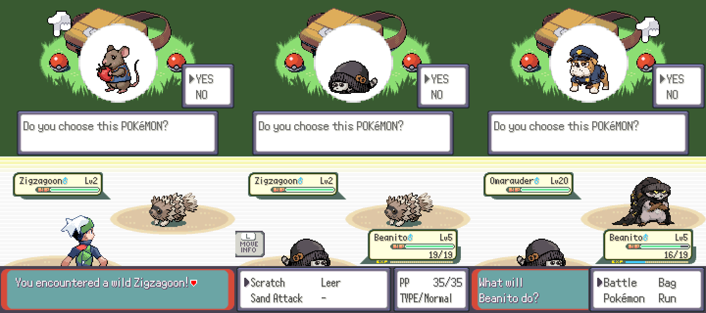

# Building the game

Emerald Remix is a set of changes applied on top of **pokeemerald-expansion 1.17.1**. The expansion
itself isn't copied into this repo; `game/apply_to_expansion.py` adds our Pokémon, moves and graphics to
a fresh checkout.



## One-time setup (Ubuntu / WSL)

```sh
sudo apt install build-essential git libpng-dev gcc-arm-none-eabi binutils-arm-none-eabi libnewlib-arm-none-eabi
git clone --depth 1 --branch expansion/1.17.1 https://github.com/rh-hideout/pokeemerald-expansion emerald-src
```

## Build

```sh
python3 emerald-remix/game/apply_to_expansion.py emerald-src            # add --debug-scripts for testing hooks
cd emerald-src && make -j4                                              # → pokeemerald.gba
```

The first build takes about 10 minutes (it compiles the expansion's tools and every Pokémon's graphics);
later builds take seconds to a minute. The apply script is safe to re-run after changing anything in
`emerald-remix/`.

## What the apply script changes

| What | Where it lives in this repo | Hook in the expansion |
|---|---|---|
| 9 new species (stats, Dex text, sprites) | `game/custom_families.h`, `graphics/starters/*` | `SPECIES_*` after `SPECIES_CUSTOM_START`, one `#include` |
| Level-up moves | `game/custom_learnsets.h` | one `#include` in `src/pokemon.c` |
| TM / tutor moves | `game/custom_learnables.json` | merged into `all_learnables.json` |
| Signature moves | `game/custom_moves.h` | `MOVE_*` in the custom-move slot, appended to `moves_info.h` |
| Pokédex | — | National numbers, Hoenn #001–009 (replacing Treecko–Swampert), sort orders |
| Starters | — | Treecko/Torchic/Mudkip → Squeesh/Beanito/Guardpup in `starter_choose.c` |
| Rival teams | — | Starter species swapped in every May/Brendan battle |
| Story: the cast and the orbs | `game/story.py`, `game/text/rival.inc`, `family.inc`, `cast.inc`, `champion.inc` | Names in text and trainer names (rival, Dad, gym leaders, Elite Four, Champion, Yaseen); Ralts renamed Heeshupeeshu; Hamza's G-Crystal ace; Route 110 gift |
| G-Moves | `game/g_moves.h`, `game/g_moves.py` | Z-Moves renamed; six signature G-Moves at the end of the Z-Move range, six G-Crystals (items 874–879) |
| Petalburg type-advice NPC | `game/petalburg_type_text.inc` | three text blocks replaced |
| Legendary cats | `game/legends.py`, `graphics/legends/*` | Kyogre, Groudon and Rayquaza's species data, moves, sprites and names in text, replaced in place |
| Tests | `game/tests/*.c` | copied into `test/`; run `make check TESTS="Remix"` |
| Debug hooks (`--debug-scripts`) | — | Script 1 = starter choice, Script 2 = wild Omarauder Lv 20, Script 3 = Hamza's Route 103 battle, Script 4 = Lv 70 Mewtwo + Hamada's Mt. Chimney battle, Script 5 = the three final forms at Lv 50 + a wild battle, Script 6 = the three legendary cats at Lv 70 + a wild Haleeb, Script 7 = Lv 70 Mewtwo + Ahmed's Mt. Chimney battle, Script 8 = Taha's first lines and Khali Ibrahim's speech |

Sprites are regenerated from the Gemini art with `tools/build_starters.sh` and `tools/build_legends.sh` (see `docs/ART_PROMPTS.md`).

## Testing without a screen

`tools/headless/gbarun.c` is a tiny mGBA-based runner that plays a script of button presses and saves
screenshots and savestates. It's how the screenshot above was made.

```sh
sudo apt install libmgba-dev imagemagick
gcc -O2 -o gbarun emerald-remix/tools/headless/gbarun.c -lmgba
printf 'wait 600\nshot title.ppm\n' | ./gbarun emerald-src/pokeemerald.gba
```

In a debug build, the title screen's **SELECT** option starts a new game quickly, and **R + START** in the
overworld opens the debug menu (Scripts → Script 1 opens the starter choice).

## Known placeholders

- **Cries** borrow existing ones (Rattata/Raticate/Skuntank, Zigzagoon/Linoone/Obstagoon, Snubbull/Granbull).
- **Footprints** borrow Rattata/Raticate, Zigzagoon/Linoone and Snubbull/Granbull.
