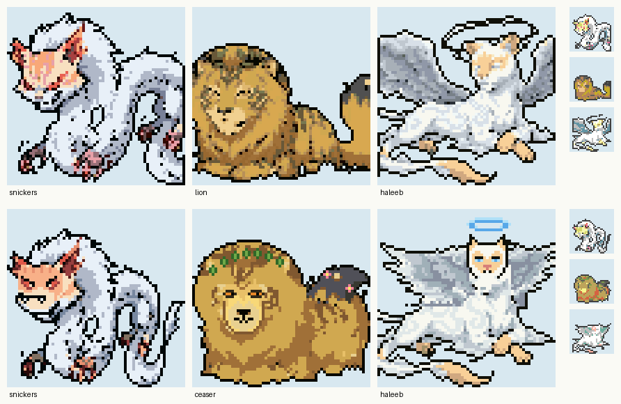

# The legendary cats

Three legendary cats take over Hoenn's weather trio. Each one **replaces the original in place**: same
species slot, same story events, same encounters. Wherever the game had Kyogre, Groudon or Rayquaza, it
now has these three, in the dialogue too. The data lives in `game/legends.py` and
`game/custom_learnsets.h`, and the sprites in `graphics/legends/`.

| | Haleeb | Ceaser | Snickers |
|---|---|---|---|
| Replaces | Kyogre | Groudon | Rayquaza |
| Look | White cloud cat with storm-cloud wings and a misty halo | Huge sleepy lion with a laurel crown, flowers in its tail | White serpent cat with red lightning claws |
| Type | Fairy / Flying | Grass / Ground | Dark / Electric |
| Ability | Drizzle (its clouds bring rain) | Drought (it brings the summer sun) | Air Lock (calms the other two's weather) |
| Category | Cloud Cat | Sun King | Storm Claw |
| HP / Atk / Def / SpA / SpD / Spe | 110 / 70 / 100 / 150 / 150 / 90 | 100 / 150 / 130 / 90 / 110 / 90 | 105 / 150 / 90 / 130 / 90 / 115 |
| Moves at Lv 70 (story level) | Hurricane, Rest, Moonblast, Roost | Earthquake, Rest, Solar Blade, Synthesis | Wild Charge, Rest, Crunch, Plasma Fists |

Base stat totals match the originals (670, 670, 680). The weather abilities are kept on purpose. The
Sootopolis story is about Kyogre's rain and Groudon's sun until Rayquaza stops them, and the scripts,
weather and battles all assume that. Each cat's moves match its weather: Haleeb's Hurricane never misses
in rain, and Ceaser's Solar Blade needs no charging turn in sun.

## What changed in the game

- Name, types, abilities, stats, Pokédex text, size, moves (level-up and TM/tutor), sprites and menu icon
- Every line of dialogue that names them, and the `{KYOGRE}` / `{GROUDON}` text placeholders

## Still the old art (needs new images)

| Where | Size | Notes |
|---|---|---|
| Back sprites | 64×64 | **Placeholders**: the front art mirrored. Send back art and they get swapped in. |
| Story cutscenes: Kyogre and Groudon in Seafloor Cavern, Cave of Origin and Sootopolis | 32×32, 4 frames | Small overworld sprites |
| Rayquaza resting at Sky Pillar | 64×64 | Overworld sprite |
| Rayquaza flying in over Sootopolis | 64×64, 5 frames | Overworld animation |
| The big Sootopolis / Sky Pillar story scenes | full screen | `graphics/rayquaza_scene/`. These are the hardest; they can stay for a while. |
| Title screen Rayquaza | full screen | Goes with Y14 |

The Primal Kyogre/Groudon and Mega Rayquaza forms still exist in the data, but this game gives you no
way to reach them.

## Converting the art

`tools/build_legends.sh` rebuilds all three (it needs `pip install opencv-python-headless`). Your concept
art is wide and painterly, which shrinks to mush at 64×64, so each one goes through four steps:

1. `tools/recompose.py` **rearranges the pose** to fit a square: Ceaser's tail tucked behind his back,
   Haleeb's wings pulled in, Snickers' tail squeezed closer. It also **flattens the fur texture** into
   clean areas of color and drops loose sparks and grass.
2. `tools/convert_sprite.py` shrinks it with an **enlarged head**, like Gen 3's big Pokémon, and fewer
   colors (`--colors`) for cleaner shading.
3. `tools/paint.py` **hand-draws the details** that never survive shrinking, from each
   `graphics/legends/<name>/paint_front.txt`: faces and eyes, Ceaser's laurel crown and tail flowers,
   Haleeb's halo. The edits name their colors, so they keep working when the conversion changes.
4. A placeholder back sprite (the front, mirrored).

